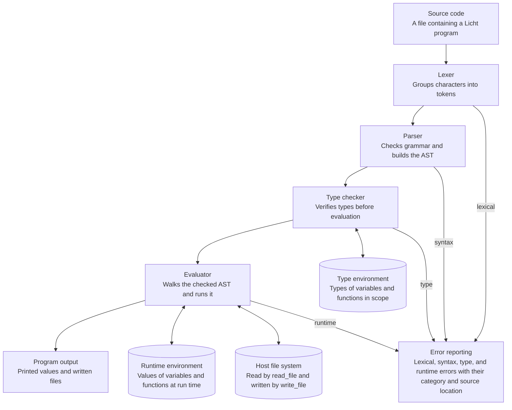
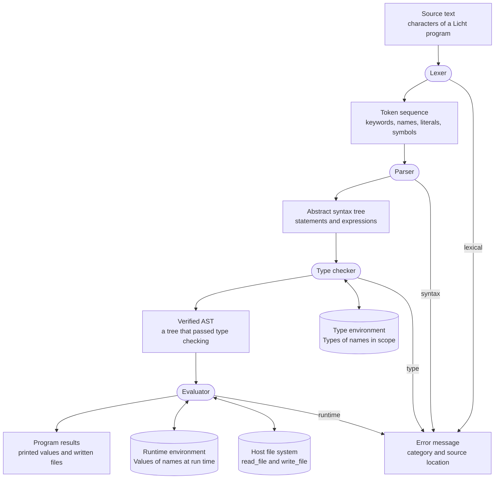
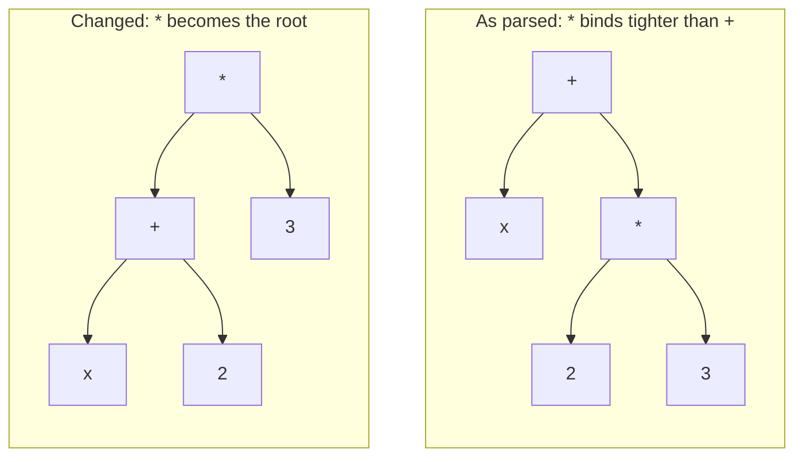

# CHAPTER THREE: METHODOLOGY

This chapter turns the design decisions of Chapter Two into a methodology, a set of requirements, an architecture, and a component design for the Licht interpreter, which Chapter Four then implements and tests.

Chapter One introduced the project: the background to the study, the motivation for a small beginner-oriented programming language, and the aim and objectives of building a reference interpreter for it. Chapter Two reviewed how Rust, Python, Haskell, Lisp, Lua, OCaml, and JavaScript runtimes execute programs, and compared the challenges they face in balancing performance against simplicity, in the timing of type errors, in syntax complexity, and in feature completeness. From that comparison it derived the main design decisions for Licht: a separate static type-checking pass with explicit function signatures and inferred local variables, a tree-walking execution model, common constructs provided directly by the language, and a focused feature set that excludes lambda functions, comprehensions, and complex iterator abstractions.

This chapter has seven sections. Section 3.1 names and describes the development methodology. Section 3.2 sets out the system requirements and the scope of the project. Section 3.3 presents the architecture of the interpreter, with diagrams of its design and of the flow of data and information through it. Section 3.4 describes the design of each component: the lexer, parser, abstract syntax tree, type checker, and evaluator. Section 3.5 illustrates the proposed syntax with a sample program. Section 3.6 describes the tools and technologies, and Section 3.7 summarises the chapter.

## 3.1 Development Methodology

The development of the Licht interpreter will follow the Iterative and Incremental Development (IID) methodology. In this methodology a system is built as a series of increments, each of which adds a working part to what already exists, and each increment is refined through repeated cycles of implementation, testing, and correction before the next one begins (Graham, 1989). For Licht, each increment is one major component of the interpreter, and the cycle for that component is repeated until its tests pass.

An interpreter consists of several closely related components, including lexical analysis, parsing, abstract syntax tree construction, type checking, and evaluation (Nystrom, 2021). Developing all of these components at once would make it difficult to isolate faults and determine which part of the system is responsible for an error. (Graham, 1989) An incremental approach therefore provides a more manageable method in which each major component can be implemented, tested, and refined before the next component is built on top of it. (Graham, 1989)

The development process will begin with the lexical analyser, which will convert source code into a sequence of tokens (Nystrom, 2021). Once tokenisation is functioning correctly, the parser will be implemented to consume the tokens and construct an Abstract Syntax Tree (AST) (Nystrom, 2021). The type-checking component will then be implemented as a separate pass over the AST so that type errors can be identified before evaluation. Finally, the evaluator will traverse the verified AST and execute the program.

Each stage will be tested independently before being integrated with the preceding and following stages. (Nystrom, 2021; Appel, 1997) For example, lexical analysis will be tested with valid and invalid source fragments before parsing is introduced. The parser will then be tested using token sequences representing expressions, declarations, functions, conditionals, and loops. The type checker will be tested using programs containing both valid and invalid type combinations, while the evaluator will be tested using ASTs that have already passed type checking. This incremental process allows errors to be isolated at the component in which they occur and reduces the complexity of debugging the complete interpreter. (Graham, 1989)

The development process can therefore be represented as a sequence of progressively integrated stages:

**Lexer → Parser → AST → Type Checker → Evaluator**

The Iterative and Incremental Development methodology is consistent with the design decisions established in Chapter Two. The review favoured implementation simplicity over maximum execution performance and selected a tree-walking interpreter with a separate type-checking pass. The incremental development method supports these decisions by allowing the individual components of the interpreter to remain small, understandable, and independently testable.

## 3.2 System Requirements

The system requirements are derived from the feature set and design decisions established in the literature review. They define the capabilities that the Licht interpreter must provide and the constraints that should guide its implementation. The requirements restate the decisions reached in Chapter Two, and each decision produces specific requirements.

The decision to check types statically before execution, with a separate pass over the AST that rejects type errors before evaluation begins, produces requirements 18 and 19 and the non-functional requirement of predictable type behaviour. The hybrid approach to type declarations, with explicit annotations for function parameters and return types and inferred types for local variables, produces requirements 6 and 7. The choice of tree-walking execution, in which source is parsed into an AST that the evaluator walks directly with no bytecode or native code, produces requirements 4 and 20 and the non-functional requirement of simplicity and manageability. The decision to build common constructs into the language, so that conditionals, arithmetic, and functions are not assembled from a small kernel of primitives, produces requirements 9, 10, and 11 and the non-functional requirement of usability. The focused feature set of conditional expressions, named functions as first-class values, `map()` and `filter()`, range-based iteration, and file input and output produces requirements 10 to 17. Finally, the deliberate exclusion of lambda functions, comprehensions, and complex iterator abstractions produces no requirements of its own and is recorded in the project scope in Section 3.2.3.

### 3.2.1 Functional Requirements

The functional requirements describe the operations that the interpreter must support.

1. The system shall accept source code written in the Licht programming language.
2. The system shall perform lexical analysis and convert valid source code into a sequence of tokens.
3. The system shall recognise keywords, identifiers, literals, operators, delimiters, and other lexical elements required by the language.
4. The system shall parse valid token sequences and construct an Abstract Syntax Tree representing the structure of the program.
5. The system shall support local variable declarations using the `let` keyword.
6. The system shall infer the types of local variables from their assigned values.
7. The system shall require explicit type annotations for function parameters and return types.
8. The system shall support integer, float, Boolean, string, and collection values required by the proposed feature set.
9. The system shall support arithmetic, comparison, and logical operations required by the language.
10. The system shall support conditional expressions using `if` and `else`.
11. The system shall support named function declarations.
12. The system shall support functions as first-class values so that named functions can be passed as arguments to other functions.
13. The system shall support `map()` as a built-in higher-order operation for transforming collection elements using a function.
14. The system shall support `filter()` as a built-in higher-order operation for selecting collection elements according to a function.
15. The system shall support basic iteration through range-based looping constructs.
16. The system shall support file input by reading data from external files.
17. The system shall support file output by writing data to external files.
18. The system shall perform a separate type-checking pass over the AST before program evaluation.
19. The system shall prevent evaluation when a type error is detected.
20. The system shall evaluate valid programs using tree-walking execution.
21. The system shall report lexical, syntax, type, and runtime errors in a form that identifies the failure sufficiently for debugging.
22. The system shall execute a valid program and produce the expected output.

The functional requirements deliberately exclude lambda functions, comprehensions, and complex iterator abstractions. These exclusions are stated formally as part of the project scope in Section 3.2.3. Logical operators such as `&&`, `||`, and `!` and floating-point numbers are included because Boolean logic is a fundamental programming concept (Pierce, 2002) and can be implemented with a small, clearly defined extension to the expression grammar.

### 3.2.2 Non-Functional Requirements

The non-functional requirements describe the qualities and constraints that should guide the implementation.

**Simplicity and manageability:** The implementation shall remain small enough to be understood, maintained, and extended without introducing unnecessary compiler or virtual-machine infrastructure. A tree-walking execution model shall therefore be preferred to bytecode generation or native-code compilation.

**Predictable type behaviour:** Type errors shall be detected before evaluation begins. The hybrid type system shall combine explicit function signatures with inferred local variable types so that type information remains predictable without requiring unnecessary annotations.

**Usability:** The language syntax shall provide common programming constructs directly rather than requiring programmers to construct them from a very small collection of primitive operations.

**Error clarity:** Errors shall be reported in a manner suitable for an educational language. Messages should identify the general category of the problem and provide enough information to locate the relevant source construct.

**Extensibility:** The interpreter architecture shall separate lexical analysis, parsing, type checking, and evaluation so that additional language features can be introduced without redesigning the entire system.

**Portability:** The interpreter shall rely primarily on the Rust standard library rather than platform-specific components or external runtime dependencies.

### 3.2.3 Scope of the System

The scope of the project is the design, implementation, and testing of a reference interpreter for Licht, a lightweight, beginner-oriented language. The scope is limited so that the interpreter stays small and understandable. The exclusions below are deliberate scope controls and are not claims that the omitted features are poor language features.

**In scope:**

- A hand-written lexer, parser, type checker, and tree-walking evaluator, written in Rust with its standard library.
- The values and operations in the functional requirements: integers, floats, Booleans, strings, and collections; arithmetic, comparison, and logical operators; `let` declarations; `if` and `else`; named functions; range-based iteration; `map()` and `filter()`; and file input and output.
- Static type checking with explicit function signatures and inferred local variable types, with type errors reported before evaluation.
- Reporting of lexical, syntax, type, and runtime errors.

**Out of scope:**

- Lambda functions, closures, list comprehensions, and complex iterator abstractions.
- A general list type in function annotations, and a general generic or parametric type system.
- Bytecode generation, a virtual machine, native-code compilation, and adaptive optimisation.
- Ownership, borrowing, and lifetime checking of the kind found in Rust.
- Maximum execution performance, which Chapter Two ranks below simplicity.
- External lexer, parser, or parser-generator libraries for the core components.

## 3.3 System Architecture

The architecture of Licht follows a sequential processing pipeline in which source code is transformed into an executable representation through several stages. The architecture is based on the tree-walking model established in Chapter Two, with a dedicated type-checking pass positioned between parsing and evaluation.

The overall processing sequence is:

```text
Source Code
    │
    ▼
  Lexer
    │
    ▼
 Tokens
    │
    ▼
 Parser
    │
    ▼
   AST
    │
    ▼
Type Checker
    │
    ├── Type Error ──► Error Message
    │
    ▼
 Evaluator
    │
    ▼
 Program Output
```

Figure 3.1 and Figure 3.2 present this sequence in more detail. Figure 3.1 shows the design of the interpreter: the four stages, the structures that two of them keep, and where each kind of error is reported. Figure 3.2 shows the form that data takes between the stages and the flow of information, including the path that stops evaluation when a type error is found.



*Figure 3.1: Overall design of the Licht interpreter*



*Figure 3.2: Data and information flow through the Licht interpreter. Rectangles are data forms, rounded boxes are processes, and cylinders are kept information. A type error leaves the flow at the type checker, so the Verified AST is never produced and the evaluator receives nothing.*

### 3.3.1 Source Code and Lexical Analysis

The process begins with a source file containing Licht code. The lexical analyser reads the source character by character and groups the characters into meaningful lexical units called tokens. Examples include keywords such as `fn`, `let`, `if`, `else`, `for`, and `return`, identifiers such as variable and function names, literals such as integers, floats, strings, and Boolean values, operators such as `+`, `-`, `*`, `/`, `%`, `<`, `>`, `&&`, `||`, and `!`, and punctuation such as parentheses, brackets, braces, commas, colons, and semicolons.

The lexer is responsible only for recognising the lexical structure of the source program. It does not determine whether the resulting sequence forms a valid program. Invalid characters or malformed lexical elements are reported by the lexer before parsing proceeds.

### 3.3.2 Parsing and Abstract Syntax Tree Construction

The parser receives the token sequence produced by the lexer and determines whether the tokens form a valid Licht program according to the language grammar. Instead of executing the program directly, the parser constructs an Abstract Syntax Tree.

The AST represents the syntactic structure of the program independently of the original formatting of the source code. (Appel, 1997; Nystrom, 2021) For example, an arithmetic expression such as `x + 2 * 3` can be represented as an addition node whose right-hand child is a multiplication node. This structure allows operator precedence to be represented explicitly and makes later type checking and evaluation independent of the original text. (Appel, 1997)

The arrangement of the nodes decides what the program means, because the evaluator computes the value of each node from the values of its children. In the tree built for `x + 2 * 3`, the multiplication node is the right-hand child of the addition node, so `2 * 3` is evaluated first and its result is added to `x`. If the arrangement were changed so that the multiplication node became the root, with the addition `x + 2` as its left-hand child, the same tokens would be evaluated as `(x + 2) * 3`. When `x` is 1, the first arrangement gives 7 and the changed arrangement gives 9, as Figure 3.3 shows. The parser therefore has to choose the arrangement correctly. In Licht this is done by the grammar in Section 3.4.2, in which multiplication, division, and remainder are nested inside addition and subtraction, so that they bind more tightly (Appel, 1997). Because the type checker and evaluator read the tree and not the source text, any error in the arrangement is carried into every later stage, which is one reason the parser is tested on its own before those stages are built (Section 3.1).



*Figure 3.3: Two arrangements of the AST for* `x + 2 * 3`*. When x is 1, the left tree gives 1 + (2 × 3) = 7 and the right tree gives (1 + 2) × 3 = 9.*

The AST will be represented using Rust data structures, with enums used to distinguish different categories of expressions and statements. The parser therefore acts as the boundary between textual syntax and the structured representation used by the remaining components.

### 3.3.3 Type Checking

After parsing, the AST is passed to the type checker. The type checker performs the first complete semantic analysis of the program. It determines whether expressions and statements are type-correct without executing the program (Pierce, 2002).

Function parameters and return types will use explicit annotations. For example:

```licht
fn add(x: int, y: int) -> int {
    x + y
}
```

The type checker will therefore know that `x` and `y` must be integers and that the function must produce an integer result. In contrast, local variables will use inference. For example:

```licht
let total = add(3, 4);
let name = "Licht";
let pi = 3.14159;
let is_ready = true;
let can_run = is_ready && pi > 3.0;
```

The types of `total`, `name`, and `is_ready` are inferred from their assigned expressions.

The type checker will maintain an environment containing the types associated with visible variables and functions. The language will not expose a general list type in explicit function parameter annotations; collection element types will instead be tracked internally by the type checker for the dedicated `map()` and `filter()` rules. When an expression refers to an identifier, its type is obtained from this environment. Function calls are checked by comparing the types of the supplied arguments with the declared parameter types. Operators are also checked to ensure that their operands have compatible types. (Pierce, 2002; Appel, 1997) When a type mismatch occurs, the type checker reports an error and the evaluator is not invoked.

### 3.3.4 Evaluation

After the AST successfully passes type checking, the evaluator traverses it and executes the program. The evaluator follows the tree-walking model selected in Chapter Two, in which each kind of node is evaluated by a rule attached to that kind (Nystrom, 2021). Each AST node has an associated evaluation behaviour. Literal nodes produce their values, variable references retrieve values from the runtime environment, binary expressions evaluate their operands and apply the required operator, function calls evaluate their arguments and invoke the corresponding function, and conditional nodes evaluate the condition before executing the selected branch.

The evaluation model is taken from published work on tree-walking interpreters and is not an untested proposal. Nystrom (2021) describes the same recursive scheme, in which each kind of expression has one evaluation rule and an environment holds the values of names, and Appel (1997) describes the separation of analysis from execution on which the two-pass design rests. The details that are specific to Licht, such as how a function call creates its environment and how an early `return` leaves a function, are design decisions that will be verified by experiment. Section 3.1 requires the evaluator to be tested on ASTs that have already passed type checking, so that each evaluation rule is exercised on its own before the complete interpreter is assembled.

Evaluation proceeds depth first. To evaluate a node, the evaluator first evaluates its children and then applies the rule for the node itself, so the value of the root is computed last. For `x + 2 * 3`, the evaluator looks up `x`, evaluates `2 * 3`, and then adds the two results. A `let` declaration evaluates its expression and records the value under the variable's name in the runtime environment, and a block of statements creates a new scope that ends with the block.

Function calls show how these parts fit together. A call to `add(3, 4)` evaluates the arguments `3` and `4`, creates a new environment in which `x` and `y` are bound to those values, and evaluates the body of `add` in that environment. The value of the final expression in the body becomes the value of the call, and an explicit `return` ends the evaluation of the body early. Because a function name is also a value in the environment, `is_even` can be passed to `filter()`, which calls it once for each element of the collection.

The evaluator is also the only stage that interacts with the outside world, so it is the only stage that can fail for reasons that depend on the environment, such as a file that cannot be read. These failures are converted into runtime errors and reported together with the other categories of error (Section 3.4.5).

The evaluator will maintain a runtime environment that maps variable and function names to their corresponding runtime values. Function calls create the environment required for parameter binding and function execution. A function can therefore be passed to operations such as `map()` and `filter()` as a first-class value. (Pierce, 2002; Nystrom, 2021)

The evaluation stage also handles operations that interact with the outside environment, including program output and file input/output. Because type checking has already occurred, the evaluator can operate on an AST whose basic type relationships have been verified.

## 3.4 Component Design

This section describes the design of each component. Figure 3.1 shows how the components fit together, and Figure 3.2 shows the data that passes between them.

### 3.4.1 Lexer Design

The lexer will be implemented as a hand-written scanner using Rust's standard library. No external lexer or parser crate will be used. The scanner will process the input as a sequence of characters and identify tokens according to a set of lexical rules.

The token categories required by the proposed syntax include:

| Category | Examples |
| --- | --- |
| Keywords | `fn`, `let`, `if`, `else`, `for`, `return` |
| Identifiers | `add`, `total`, `numbers`, `is_even` |
| Integer literals | `0`, `3`, `10`, `42` |
| Float literals | `0.5`, `3.14`, `10.0` |
| String literals | `"Licht"`, `"data.txt"` |
| Boolean literals | `true`, `false` |
| Arithmetic operators | `+`, `-`, `*`, `/`, `%` |
| Comparison operators | `<`, `>`, `<=`, `>=`, `==`, `!=` |
| Logical operators | `&&`, `\|\|`, `!` |
| Assignment/punctuation | `=`, `:`, `,`, `;` |
| Delimiters | `(`, `)`, `[`, `]`, `{`, `}` |
| Function return operator | `->` |

Whitespace and comments will be recognised and discarded where appropriate so that they do not become part of the syntactic structure presented to the parser. (Ierusalimschy et al., 2025)

The lexer must also distinguish between single-character operators and multi-character operators. For example, `=` and `==` have different meanings, as do `-` and `->`. The scanner therefore has to examine the following character when necessary before deciding which token to produce. (Reis, 2011; Thain, 2023) This is particularly important for multi-character operators such as `==`, `!=`, `<=`, `>=`, `&&`, `||`, and `->`, while `!` remains a single-character logical operator when it is not followed by `=`.

### 3.4.2 Parser and Grammar Design

The parser will also be implemented manually without an external parsing library. The grammar will define the valid syntactic structures of Licht and will provide the rules required to construct the AST.

A simplified representation of the proposed grammar is shown below:

```ebnf
program        = { declaration } ;

declaration    = function_declaration
               | statement ;

function_declaration
               = "fn" identifier "(" [ parameters ] ")" "->" type
                 block ;

parameters     = parameter { "," parameter } ;
parameter      = identifier ":" type ;

statement      = variable_declaration
               | if_statement
               | for_statement
               | return_statement
               | expression_statement ;

variable_declaration
               = "let" identifier "=" expression ";" ;

if_statement   = "if" expression block
                 [ "else" block ] ;

for_statement  = "for" identifier "in" expression block ;

return_statement
               = "return" expression ";" ;

block          = "{" { statement } [ expression ] "}" ;

expression     = assignment ;

assignment     = logical_or
               | identifier "=" expression ;

logical_or     = logical_and { "||" logical_and } ;

logical_and    = comparison { "&&" comparison } ;

comparison     = term { comparison_operator term } ;

term           = factor { ("+" | "-") factor } ;

factor         = unary { ("*" | "/" | "%") unary } ;

unary          = [ ("-" | "!") ] primary ;

primary        = literal
               | identifier
               | function_call
               | list_literal
               | "(" expression ")" ;

literal        = integer_literal
               | float_literal
               | string_literal
               | boolean_literal ;

integer_literal
               = digit { digit } ;

float_literal  = digit { digit } "." digit { digit } ;

string_literal = '"' { string_character } '"' ;

boolean_literal
               = "true"
               | "false" ;

function_call  = identifier "(" [ arguments ] ")" ;

arguments      = expression { "," expression } ;

list_literal   = "[" [ arguments ] "]" ;

type           = "int"
               | "float"
               | "bool"
               | "string" ;
```

The grammar is intended to describe the core syntax illustrated by the proposed sample program. As implementation progresses, additional productions may be introduced where required by the final language specification. The grammar will be kept deliberately small so that the parser remains understandable and the language avoids unnecessary syntactic complexity.

Logical operators are included because Boolean composition is a fundamental part of program logic. The grammar gives `!` unary precedence over binary logical operators, while `&&` binds more tightly than `||`. (Python Software Foundation, n.d.) This produces the conventional precedence relationship `!` > `&&` > `||` (Python Software Foundation, n.d.) and allows compound conditions to be expressed without requiring excessive parentheses. Float literals require digits on both sides of the decimal point, which keeps lexical recognition unambiguous in the minimal grammar. (Python Software Foundation, n.d.)

The parser will construct AST nodes while recognising the grammar rather than creating an intermediate representation that has no later use. Expressions and statements will therefore be represented directly in forms required by the type checker and evaluator.

### 3.4.3 Abstract Syntax Tree Design

The AST will provide a structured representation of Licht programs. A possible organisation of the main node categories is shown below:

```text
Program
├── Declaration*
│
├── FunctionDeclaration
│   ├── Name
│   ├── Parameter*
│   ├── ReturnType
│   └── Body
│
├── Statement
│   ├── Let
│   ├── If
│   ├── For
│   ├── Return
│   └── ExpressionStatement
│
└── Expression
    ├── Literal
    ├── Variable
    ├── Binary
    ├── Unary
    ├── Assignment
    ├── Call
    └── List
```

Rust enums are suitable for representing these alternatives because each AST node belongs to one of a finite number of syntactic categories. (Klabnik & Nichols, 2023) Associated data can then store the information specific to each node, such as the operator used by a binary expression or the arguments of a function call. (Klabnik & Nichols, 2023)

This structure supports pattern matching in both the type checker and evaluator. (Klabnik & Nichols, 2023) Each component can inspect an AST node and perform the operation corresponding to its variant without requiring a large collection of unrelated classes or dynamically identified node types.

### 3.4.4 Type Checker Design

The type checker will perform a recursive traversal of the AST and determine the type produced by each expression. A type environment will store the known types of variables and functions within the current scope.

For local declarations, the checker will first determine the type of the expression assigned to the variable and then associate that type with the variable name. Collection expressions will carry their element type internally, even though collection types are not part of the language's explicit `type` grammar. For example:

```licht
let total = add(3, 4);
```

After checking the call to `add`, the expression has type `int`, and the environment can therefore record `total` as an integer.

For function declarations, explicit parameter and return annotations provide the expected function signature. When a function body is checked, the parameter names are inserted into a function-local environment using their declared types. The type checker then verifies that the final function result is compatible with the declared return type.

Conditional expressions will require the condition to have type `bool`. Their resulting branches will also be checked for compatible result types where the expression produces a value. Binary operators will similarly impose type requirements on their operands. For example, arithmetic operators will operate on numeric values, where integer and float operations follow the language's numeric rules, comparison operations will produce Boolean results, and logical operators `&&` and `||` will require Boolean operands. The unary `!` operator will require a Boolean operand and produce a Boolean result.

Ordinary function calls will be checked by verifying the number and type of arguments against the corresponding function declaration. The built-in operations `map()` and `filter()` will instead have dedicated type-checking rules rather than ordinary user-defined function signatures. This avoids introducing a general parametric or generic type system while still allowing these operations to work across collections containing different element types. For `map()`, the type checker will verify that the first argument is a function whose parameter type matches the element type of the collection supplied as the second argument. The result is treated as a collection whose element type is the return type of the supplied function. For `filter()`, the supplied function must accept the collection's element type and return `bool`, while the resulting collection retains the original element type.

The type checker will terminate the interpretation process when an invalid type relationship is found. This preserves the two-pass model in which a program is evaluated only after it has successfully passed static analysis.

### 3.4.5 Evaluator Design

The evaluator will recursively traverse the AST and compute the result of each node. (Nystrom, 2021) An evaluation environment will store the runtime values of variables and functions. (Nystrom, 2021)

Expressions will be evaluated according to their structure. Integer, float, string, and Boolean literals return their stored values, a variable expression retrieves a value from the current environment, and a binary expression evaluates its operands before applying the relevant operation. Logical expressions will evaluate Boolean operands according to the corresponding `&&` or `||` operator, while the unary `!` operator will negate a Boolean value. A conditional expression first evaluates its Boolean condition and then evaluates only the selected branch.

Function calls will evaluate their arguments and bind the resulting values to the function's parameters in a new execution environment. (Nystrom, 2021) The function body is then evaluated within that environment. The value of the final expression in a function body will be used as the function's implicit return value, while an explicit `return` statement will provide an early return from the function. (Nystrom, 2021)

The proposed syntax therefore supports both ordinary function composition and higher-order use without requiring lambda functions. The `map()` and `filter()` operations are treated as built-in higher-order operations by the evaluator, matching the dedicated type-checking rules described above. For example:

```licht
fn is_even(n: int) -> bool {
    n % 2 == 0
}

fn double(n: int) -> int {
    n * 2
}

let numbers = [1, 2, 3, 4, 5, 6];
let evens = filter(is_even, numbers);
let doubled = map(double, numbers);
```

In this example, the named functions `is_even` and `double` are passed as values to the built-in operations `filter()` and `map()`. The type checker handles these operations using their dedicated rules rather than requiring a general generic list type. This demonstrates how higher-order functionality can be provided without implementing anonymous functions, closures, or a full parametric type system.

The evaluator will also implement basic range-based iteration. For example:

```licht
for i in range(0, 10) {
    print(i);
}
```

The loop will obtain the values represented by the range and evaluate the loop body for each value.

File input and output will be provided through built-in operations such as:

```licht
let contents = read_file("data.txt");
write_file("out.txt", contents);
```

These operations will connect the interpreter to the host file system while keeping file handling at the language level. (Klabnik & Nichols, 2023) The evaluator will therefore be responsible for invoking the corresponding Rust standard-library file operations and converting failures into interpreter-level runtime errors.

## 3.5 Proposed Licht Language Syntax

The following sample demonstrates how the main features selected from the literature review are expected to appear in Licht source code:

```licht
// Licht sample program

fn add(x: int, y: int) -> int {
    x + y
}

fn abs(n: int) -> int {
    if n < 0 {
        return -n;
    }
    n
}

let total = add(3, 4);
let name = "Licht";
let pi = 3.14159;
let is_ready = true;
let can_run = is_ready && pi > 3.0;

if total > 5 {
    print("big");
} else {
    print("small");
}

for i in range(0, 10) {
    print(i);
}

fn is_even(n: int) -> bool {
    n % 2 == 0
}

fn double(n: int) -> int {
    n * 2
}

let numbers = [1, 2, 3, 4, 5, 6];
let evens = filter(is_even, numbers);
let doubled = map(double, numbers);

print(evens);
print(doubled);

let contents = read_file("data.txt");
write_file("out.txt", contents);
```

The example demonstrates several design decisions established in Chapter Two and formalised in this chapter. Function parameters and return types are explicitly annotated, while local variables rely on type inference. Integer, float, string, and Boolean literals are supported directly, while logical operators allow Boolean values and comparison results to be combined into compound conditions. Conditional expressions and range-based iteration are provided directly by the language. Named functions can be passed as values to `map()` and `filter()`, eliminating the need for lambda syntax. File input and output are exposed through built-in operations, providing the language with the ability to work with persistent external data.

The sample does not include lambda expressions, list comprehensions, or a dedicated iterator abstraction because these features were excluded from the proposed feature set (Section 3.2.3). Logical operators are included because they provide a small amount of additional syntax for expressing fundamental Boolean relationships without requiring a more complex abstraction. The syntax therefore reflects the objective of keeping the language sufficiently expressive for practical examples while maintaining a small implementation.

## 3.6 Tools and Technologies

### 3.6.1 Rust

Rust will be used as the implementation language for the interpreter. Rust provides algebraic data types through enums, pattern matching, strong static typing, and memory safety. (Klabnik & Nichols, 2023) These features are particularly suitable for representing AST nodes, token kinds, and runtime values. (Klabnik & Nichols, 2023)

The use of Rust also aligns the implementation with the literature reviewed in Chapter Two, which identified Rust's clear type rules and predictable behaviour as useful characteristics while recognising that its complete ownership and borrowing model would be beyond the scope of the proposed language itself.

### 3.6.2 Rust Standard Library

The implementation will rely on Rust's standard library rather than third-party crates for the core interpreter components. The lexer, parser, type checker, evaluator, runtime environment, and file I/O mechanisms will therefore be implemented directly.

File operations will use the facilities provided by the Rust standard library. Collections such as vectors and hash maps will also be used where appropriate for representing lists, environments, and mappings between names and values.

### 3.6.3 Hand-Written Lexer and Parser

No parser-combinator, lexer-generation, or parser-generation crate will be used. The lexer and parser will be written manually. This approach gives direct control over the grammar and keeps the implementation architecture visible for educational purposes. (Reis, 2011; Thain, 2023)

A hand-written implementation also makes it possible to trace the path from source text to tokens, from tokens to AST nodes, and from AST nodes to type checking and evaluation without relying on abstractions provided by external parsing frameworks. (Nystrom, 2021; Appel, 1997)

### 3.6.4 Development Environment

The interpreter will be developed as a standalone Rust application. Source files containing Licht programs will be supplied to the interpreter for parsing, type checking, and evaluation. The implementation will be organised into separate modules corresponding to the major interpreter components so that each part can be developed and tested independently.

## 3.7 Chapter Summary

This chapter presented the methodology and design used for the development of the Licht interpreter. The Iterative and Incremental Development (IID) methodology was selected so that the lexer, parser, type checker, and evaluator can be implemented and tested in manageable stages. The system requirements were defined in terms of the functional capabilities and non-functional qualities derived from the literature review, and the scope of the project was stated, including the features that are deliberately excluded.

The architecture of the interpreter follows a pipeline from source code through lexical analysis, parsing, AST construction, type checking, and tree-walking evaluation, and it was presented through a design diagram, a data and information flow diagram, and a worked example of how the arrangement of the AST determines the result. The component design described the responsibilities of the lexer, parser, AST, type checker, and evaluator, while the proposed grammar and sample program established the intended syntax of the language. The implementation will use Rust and its standard library, with the core interpreter components written without external crates. Together, these decisions provide the foundation for the implementation and subsequent testing of the Licht interpreter.

## References

Appel, A. W. (1997). *Modern compiler implementation in ML*. Cambridge University Press. https://doi.org/10.1017/CBO9780511811449

Graham, D. (1989). Incremental development: Review of nonmonolithic life-cycle development models. *Information and Software Technology, 31*(1), 7–20. https://doi.org/10.1016/0950-5849(89)90049-9

Ierusalimschy, R., de Figueiredo, L. H., & Celes, W. (2025). *Lua 5.4 reference manual*. Lua.org. https://www.lua.org/manual/5.4/manual.html

Klabnik, S., & Nichols, C. (2023). *The Rust programming language* (2nd ed.). No Starch Press. https://nostarch.com/rust-programming-language-2nd-edition

Nystrom, R. (2021). *Crafting interpreters*. https://craftinginterpreters.com/

Pierce, B. C. (2002). *Types and programming languages*. MIT Press. https://mitpress.mit.edu/9780262162098/types-and-programming-languages/

Python Software Foundation. (n.d.). *The Python language reference*. Python Documentation. https://docs.python.org/3/reference/index.html

Reis, A. J. D. (2011). Recursive-descent parsing. In *Compiler construction using Java, JavaCC, and Yacc*. Wiley. https://doi.org/10.1002/9781118112762.ch9

Thain, D. (2023). *Introduction to compilers*. University of Notre Dame. https://www3.nd.edu/~dthain/compilerbook/compilerbook.pdf
