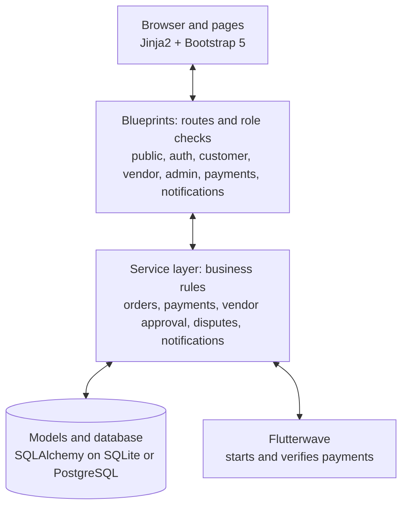
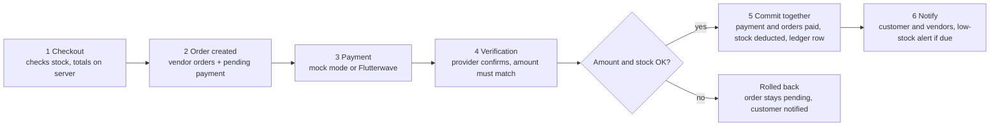
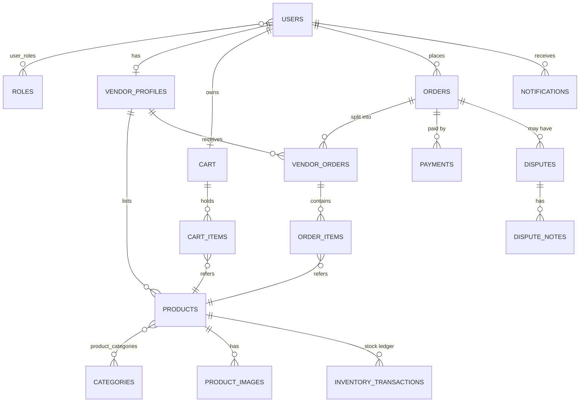

**CHAPTER THREE:**

**SYSTEM ANALYSIS AND DESIGN**

# 3.1 Introduction

This chapter analyses the problem and designs the multi-vendor platform described in Chapter One. The analysis part reviews existing work, identifies the users, and states their requirements, the functional and non-functional requirements, and the hardware and software the system needs. The design part covers the user interface, the system design and the database. The choices follow the objectives in Section 1.3 and the literature in Chapter Two, in particular the need for seller governance, role-based access, server-verified payment, consistent stock control and modular architecture (Fowler, 2002; Hagiu & Wright, 2015; Barkley et al., 1998).

The system was built iteratively. The work was divided into small functional increments, each analysed, designed, implemented and tested before the next began, following the dependency order of the marketplace: accounts and roles, vendor approval, products, cart and checkout, payment, inventory, order processing, notifications and disputes.

# PART A: ANALYSIS

# 3.2 Analysis of Existing Work

Small businesses in Nigeria that sell online today generally use one of three arrangements.

1. **Social media and messaging channels.** The vendor posts products, agrees prices in conversation and records orders and stock by hand. Product, order and payment information sits in separate places, so no single record of business activity exists.
2. **Large third-party marketplaces.** Platforms such as Jumia give sellers a ready audience, logistics and a payment service, but they operate at a scale and with an integration of services that a small seller cannot influence (Jumia Technologies AG, 2025). Marketplaces such as Etsy and Taobao show that a multi-vendor model works, but they serve their own seller communities and rules (Alibaba Group, 2020; Etsy, n.d.-a).
3. **Classified listings.** Sites such as Jiji let sellers advertise with a declared location, but the transaction itself, including payment and stock control, takes place outside the platform (Jiji Nigeria, n.d.).

These arrangements share weaknesses that match the problems stated in Section 1.2:

- Stock is not linked to sales, so a product can be sold after it has run out (DeHoratius & Raman, 2008; Nguyen et al., 2018).
- A buyer comparing several sellers of the same item has no consistent view of price and seller location.
- Payment confirmation is not tied to an order record, so it has to be checked manually.
- There is no shared place to resolve a dispute or to record a seller's approval status.
- Order and payment updates reach buyers and sellers through separate, unrecorded channels.

The proposed system answers each weakness:

| Weakness in current practice | Proposed system response |
| --- | --- |
| Disconnected product, order and payment records | One database holding products, carts, orders, payments and status history |
| Stock not linked to sales | Stock is deducted automatically when payment is verified, with a recorded inventory transaction and a low-stock alert |
| No view of seller location when comparing offers | Each vendor gives a business location at registration; search results show price and vendor location side by side |
| Uncontrolled seller onboarding | Vendors register as pending and are approved, rejected or suspended by the administrator |
| Unverified payment | Payment is confirmed on the server, by the payment provider's verification call or the demonstration mode, never by a browser message alone |
| Scattered updates | Internal notifications for payment, order, stock, vendor-status and dispute events |
| No route for complaints | Customers open disputes; the administrator reviews, annotates and resolves them |

Two decisions need explanation. First, a vendor account also carries the customer role, so an approved vendor can search, fill a cart and check out as a buyer, which supports vendors who buy from other vendors, as Chapter Two argued. Second, the system does not compute distances. Location is declared by the vendor and shown to the buyer, who judges proximity, in line with the scope in Section 1.5.

# 3.3 User Identification

The system has three groups of users, plus visitors who are not logged in.

| User | Description | Main interests |
| --- | --- | --- |
| Visitor | A person who has not logged in. Can browse and search but cannot use the cart | Finding products and sellers before deciding to register |
| Customer | A registered buyer, such as an individual or a small business buying stock | Finding suitable products, paying safely, tracking orders, resolving problems |
| Vendor | A small business that sells through the platform. Registers as pending and becomes active only when approved. Also holds the customer role | Listing products, controlling stock, receiving and fulfilling orders |
| Administrator | The platform operator | Admitting trustworthy vendors, keeping the catalogue organised, overseeing orders and resolving disputes |

# 3.4 User Requirements

User requirements describe what each group needs from the system, in the users' own terms. They are made precise in Section 3.5.

**Customer**

- I want to find products quickly and compare prices and where each seller is located.
- I want to buy from several vendors in a single purchase.
- I want to pay online and be sure the payment was received.
- I want to see the progress of my order and be told when it changes.
- I want a way to complain if something goes wrong.

**Vendor**

- I want to register my business and be approved so that buyers can trust me.
- I want to list products with pictures, prices and categories.
- I want to know how much stock I have and be warned before I run out.
- I want to see only my own orders and update their progress.
- I want to buy from other vendors using the same account.

**Administrator**

- I want to review vendors before they sell and be able to suspend them later.
- I want to keep categories organised.
- I want to see all orders, record delivery progress and handle disputes.

# 3.5 Functional Requirements

| ID | Requirement | Main actor |
| --- | --- | --- |
| FR-01 | Register, log in and log out with a hashed password | All |
| FR-02 | Enforce role-based authorisation for customer, vendor and administrator functions | All |
| FR-03 | Register as a vendor with a business location; the account starts as pending approval | Vendor |
| FR-04 | Approve, reject, suspend and reactivate vendors, with the reason and the change recorded | Administrator |
| FR-05 | Create, edit, activate, deactivate and delete products, with images and one or more categories | Vendor |
| FR-06 | Record stock per product, adjust or restock it manually, and raise a low-stock alert at a threshold | Vendor |
| FR-07 | Search, filter, sort and paginate products | Customer |
| FR-08 | Show each search result with its price and the vendor's location | Customer |
| FR-09 | Keep a persistent cart that can hold products from several vendors | Customer |
| FR-10 | Check out with shipping details; calculate the order total on the server | Customer |
| FR-11 | Pay through the demonstration mode or Flutterwave, and confirm payment on the server | Customer |
| FR-12 | Split one order into vendor-specific orders | System |
| FR-13 | Deduct stock automatically when payment succeeds and record each change | System |
| FR-14 | Move vendor orders from paid to processing, ready for dispatch and dispatched | Vendor |
| FR-15 | Record delivery stages after dispatch | Administrator |
| FR-16 | Send internal notifications for payment, order, stock, vendor-status and dispute events | System |
| FR-17 | Open a dispute on an order, add notes, and review and resolve it | Customer, administrator |
| FR-18 | Let an approved vendor use search, cart and checkout as a buyer | Vendor |

# 3.6 Non-Functional Requirements

| Quality | Requirement | Basis |
| --- | --- | --- |
| Security | Hash passwords, protect forms against cross-site request forgery, escape output, use parameterised database queries, check ownership of every record a user changes | OWASP Foundation (n.d.-a, n.d.-b, n.d.-c) |
| Integrity | Order creation, payment confirmation and stock deduction must succeed or fail together; stock must never fall below zero | Haerder & Reuter (1983) |
| Usability | Responsive layout for desktop, tablet and mobile browsers; clear status labels | Marcotte (2010); Kumar (2022) |
| Performance | Paginate product lists and filter in the database | Design target |
| Maintainability | Separate routes, business logic and data models | Fowler (2002); Parnas (1972) |
| Portability | Run on SQLite for development and PostgreSQL in production without code changes | Design target |

# 3.7 System Requirements

## 3.7.1 Hardware requirements

The system is a web application, so the hardware needed differs for the developer, the server and the user. The figures below are recommended minimums for a small deployment, not measured limits.

| Role | Component | Minimum | Recommended |
| --- | --- | --- | --- |
| Development computer | Processor | Dual-core, 2 GHz | Quad-core, 2.5 GHz or higher |
| | Memory | 4 GB | 8 GB |
| | Storage | 2 GB free | 10 GB free (project, packages, images, Docker) |
| Server | Processor | 1 virtual CPU | 2 virtual CPUs |
| | Memory | 1 GB | 2 GB or more |
| | Storage | 10 GB | 20 GB or more, growing with product images |
| | Network | Internet connection | Stable broadband with a public address |
| User device | Device | Any computer, tablet or smartphone | Any computer, tablet or smartphone |
| | Network | Internet connection | Stable internet connection |

## 3.7.2 Software requirements

| Role | Software | Purpose |
| --- | --- | --- |
| Development | Python 3.12 and pip | Run the application and install libraries |
| | Flask 3, Flask-SQLAlchemy 3.1, Flask-Migrate 4, Flask-Login 0.6, Flask-WTF 1.2, WTForms 3.1 | Framework, data access, migrations, sessions and forms |
| | Pillow 10, requests 2, python-dotenv, python-slugify, python-dateutil, email-validator | Image handling, payment API calls, settings, URL names, dates and email checks |
| | pytest 8 | Automated testing |
| | Git and a code editor (for example Visual Studio Code) | Version control and editing |
| | Docker (optional) | Run the application from the supplied container configuration |
| Server | Linux operating system with Docker or Python 3.12 | Host the application |
| | PostgreSQL (optional) | Production database; SQLite is used by default |
| | A reverse proxy with an HTTPS certificate | Encrypted connections in production |
| User | A current web browser (Chrome, Edge, Firefox or Safari) with JavaScript enabled | Use the system. Page styles and icons load from public content delivery networks, so the browser needs internet access |
| External | Flutterwave account and API keys | Online payment in live mode; not needed in demonstration mode |

# PART B: DESIGN

# 3.8 User Interface Design

## 3.8.1 Design principles

The interface follows four principles. It is **role-based**, so each user sees only the actions that belong to the role. It is **consistent**, so the same page layout, product card, status badge and form style appear throughout. It is **responsive**, so one set of pages serves desktop, tablet and phone through Bootstrap 5's grid and collapsing navigation, in line with the usability requirement in Section 3.6 (Marcotte, 2010). It gives **clear feedback**, so every action shows a success, warning or error message and every order or dispute shows a coloured status label.

## 3.8.2 Layout and navigation

All pages extend one base template. Visitors see a top navigation bar with the brand, links to the marketplace and categories, and log-in and registration buttons. After login the layout changes to an application shell with a side menu. The side menu shows a dashboard link and then the links for the user's role:

| Role | Side menu items |
| --- | --- |
| Customer | Marketplace, cart (with item count), orders, disputes, notifications |
| Vendor | Products, inventory, orders, plus the customer items |
| Administrator | Vendors, categories, orders, disputes |

A notification count is shown in the shell on every page. On narrow screens the menu collapses behind a toggle button.

## 3.8.3 Main screens

| Screen | User | Purpose |
| --- | --- | --- |
| Home page | Visitor | Introduce the marketplace and lead to browsing |
| Login and registration | Visitor | Create an account, choosing customer or vendor, or sign in |
| Marketplace (product list) | All | Search, filter by category, price, vendor and availability, sort and page through products shown as cards with price and vendor |
| Product detail | All | Images, description, price, stock status, vendor and add-to-cart |
| Vendor store | All | Products of one approved vendor |
| Cart | Customer | Review items, change quantity, remove items, proceed to checkout |
| Checkout | Customer | Enter shipping details and place the order |
| Order list and order detail | Customer, vendor, administrator | Follow status, items, payment and delivery |
| Customer dashboard | Customer | Summary of orders and disputes |
| Vendor dashboard, products, product form, inventory | Vendor | Manage listings, see low stock, restock |
| Administrator dashboard, vendors, categories | Administrator | Approve and suspend vendors, manage categories |
| Disputes and dispute detail | Customer, administrator | Open, discuss and resolve complaints |
| Notifications | All signed-in users | Read and mark messages |

## 3.8.4 Forms, feedback and visual style

Forms are validated on the server, and errors are reported to the user as messages on the page. Destructive actions, such as deleting a product or clearing a cart, are sent as protected form submissions, not as links. Status labels use colour with text, so meaning does not depend on colour alone. The visual style uses the DM Sans and Space Grotesk typefaces, Bootstrap Icons and a shared style sheet, so a change to a colour or spacing is made once.

# 3.9 System Design

## 3.9.1 System architecture

The system uses a layered architecture with three tiers, following the separation of presentation, business logic and data recommended in the architecture literature (Fowler, 2002; Parnas, 1972).

1. **Presentation tier.** Jinja2 templates styled with Bootstrap 5 and a small amount of JavaScript produce the responsive interface described in Section 3.8, so no separate mobile application is needed.
2. **Application tier.** Flask handles requests through seven blueprints: authentication, public pages, customer, vendor, administrator, payments and notifications. Each blueprint checks the user's role and then calls a **service layer** that holds the business rules for orders, payments, vendor approval, disputes and notifications. Keeping the main business rules in services, rather than in the route functions, follows the Service Layer pattern described by Fowler (2002).
3. **Data tier.** SQLAlchemy maps Python classes to relational tables. SQLite serves development and testing; PostgreSQL can be used in production by changing a single configuration value.

One external service sits outside the tiers: the Flutterwave payment API, which the payment service calls to start and verify payments. The application is created by a factory function for a chosen configuration (development, testing or production), so the test suite can run against an in-memory database while the live system uses a file or server database.

*Figure 3.1: System architecture.* Requests pass from the browser through a blueprint to the service layer and the database; only the payment service calls Flutterwave.

## 3.9.2 Use cases

| Actor | Use cases |
| --- | --- |
| Visitor | Browse products, search and filter, view a product, view a vendor store, register, log in |
| Customer | Manage cart, check out, pay, track orders, open and follow disputes, read notifications |
| Vendor | Register for approval, manage products, manage inventory, process own orders, read notifications, and all customer use cases once approved |
| Administrator | Approve, reject, suspend and reactivate vendors, manage categories, view all orders, record delivery stages, resolve disputes |

## 3.9.3 Process design

**Vendor onboarding.** A person who registers as a vendor receives both the vendor and customer roles, and the vendor profile starts as pending approval. A pending vendor can log in but cannot create products. The administrator approves or rejects the application, and can later suspend or reactivate the vendor. Each change is saved in the status history with the administrator's name, the time and any reason, and the vendor is notified. Because the vendor's location is declared during registration, approval is the point at which the administrator can review it.

**Checkout, payment and stock deduction.** The purchase cycle links the cart, the order, the payment and the stock. It works as follows.

1. **Checkout.** The server checks that every cart item is still available and that the quantity does not exceed stock. It calculates the total from stored prices, not from any value sent by the browser.
2. **Order creation.** The server creates the order, one vendor order for each vendor in the cart, the order items and a pending payment with a unique reference. The cart is then emptied. Stock is checked here but not yet deducted.
3. **Payment.** In demonstration mode the customer confirms a mock payment. In Flutterwave mode the customer is sent to the provider's checkout page.
4. **Verification.** The server confirms the result with the provider and checks that the amount and currency match the order. A callback message from the browser alone is never accepted as proof (Flutterwave, n.d.; OWASP Foundation, n.d.-d). A webhook from the provider is accepted only if its signature header matches the configured secret.
5. **Completion.** In one database transaction the system marks the payment successful, sets the order and all vendor orders to paid, deducts each product's stock only if enough remains, writes a ledger entry for each deduction, and sets a product to out of stock when it reaches zero. If any step fails, the transaction is rolled back (Haerder & Reuter, 1983).
6. **Notification.** The customer and each vendor receive a notification, and a vendor receives a low-stock alert when stock falls to or below the product's threshold.

A payment that has already been processed is ignored if it arrives again, so repeated callbacks cannot deduct stock twice.

*Figure 3.2: Checkout and payment flow.* The stock check runs twice: at checkout, and again as a condition of the deduction when the payment is confirmed.

**Order fulfilment.** Each vendor moves its own vendor order from paid to processing, then ready for dispatch, then dispatched, and the system rejects any other move. After dispatch the administrator records delivery stages: in transit, out for delivery, delivered, delivery failed or returned. The physical movement of goods is carried out by external providers and is outside the system, as stated in Section 1.5.

**Disputes.** A customer can open a dispute only on the customer's own order. The administrators are notified, and the administrator and customer can add notes. The administrator moves the dispute through open, under review, resolved and closed, and the customer is notified of each change. Disputes are resolved manually, in line with Section 1.3.

## 3.9.4 Security design

Security is applied at several levels, because a single login check does not protect a marketplace (OWASP Foundation, n.d.-a, n.d.-b, n.d.-c).

| Threat | Design response |
| --- | --- |
| Stolen credentials | Passwords are stored only as salted hashes; sessions use strong session protection and HTTP-only cookies |
| Forged requests | Every form carries a CSRF token; session cookies use the SameSite attribute |
| Script injection | Template output is escaped by default |
| Database injection | All queries go through the object-relational mapper with bound parameters |
| Access to another user's data | Role decorators protect each route, and each action checks that the record belongs to the logged-in user or vendor |
| Price or payment tampering | Totals and payment confirmation are computed and verified on the server |
| Malicious uploads | Only listed image types are accepted, and upload size is limited to 5 MB |
| Insecure transport | In production, cookies are marked secure and the application is served over HTTPS |

# 3.10 Database Design

The database is relational and has 21 tables, grouped by purpose below. Every table also stores creation and update times.

| Group | Tables | Purpose |
| --- | --- | --- |
| Identity and access | users, roles, user_roles, customer_profiles | Accounts, and a many-to-many link so one user can hold several roles |
| Vendors | vendor_profiles, vendor_status_history | Business details, location, approval status, and an audit trail of status changes |
| Catalogue | categories, products, product_categories, product_images | Products owned by a vendor, linked to several categories |
| Shopping | carts, cart_items | One cart per user with price captured when an item is added |
| Orders | orders, vendor_orders, order_items | A customer order, its per-vendor parts, and the items in each part |
| Payments | payments, payment_events | Payment records with a unique reference, and raw provider events |
| Inventory | inventory_transactions | A ledger of every stock change with the previous and new quantity |
| Communication | notifications, disputes, dispute_notes | In-app messages and the dispute process |

*Figure 3.3: Main entities and relationships.* Customer profiles, vendor status history and payment events are omitted for clarity.

Four design decisions shape the schema.

- **Roles as data.** A many-to-many link between users and roles lets a vendor hold both the vendor and customer roles. This is how a vendor can buy from other vendors without any special case in the code.
- **Vendor location in the vendor profile.** Business address, city and state are stored with the vendor profile and joined to products when results are listed, so location is declared once and reused for every listing.
- **Order splitting.** One order holds the customer, shipping details and total. It is divided into vendor orders, each with its own status and total, so each vendor sees and processes only its own part.
- **Stock ledger.** Current stock is stored on the product, and every change is also written to the ledger with the order and payment reference. This gives vendors a traceable history and supports the consistency requirement in Section 3.6 (DeHoratius & Raman, 2008).

# 3.11 Chapter Summary

This chapter analysed existing ways of selling online, identified the users and their requirements, defined 18 functional and six non-functional requirements, and stated the hardware and software the system needs. It then described the role-based interface, the three-tier architecture with a service layer, the checkout and payment process, the security measures and the 21-table relational schema. Chapter Four describes how this design was implemented and tested.
