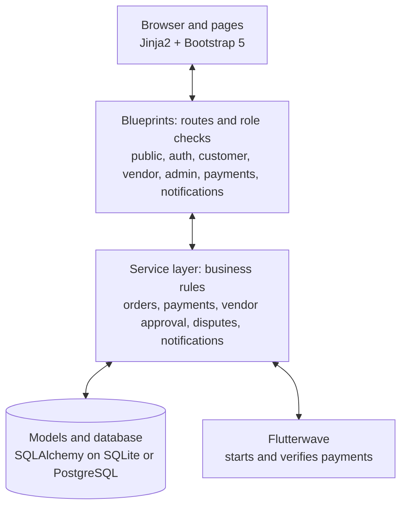
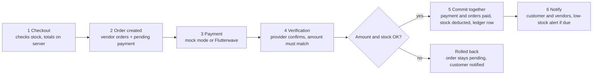

**CHAPTER THREE:**

**SYSTEM ANALYSIS AND DESIGN**

# 3.1 Introduction

This chapter explains how the multi-vendor platform described in Chapter One was analysed and designed. It states the development methodology, reviews how small businesses currently sell online, defines the proposed system, and sets out its requirements, architecture, database, process logic and security design. The design choices follow the objectives in Section 1.3 and the literature in Chapter Two, in particular the need for seller governance, role-based access, server-verified payment, consistent stock control and modular architecture (Fowler, 2002; Hagiu & Wright, 2015; Barkley et al., 1998).

# 3.2 Development Methodology

The system was built with an iterative and incremental approach. The work was divided into small functional increments, each analysed, designed, implemented and tested before the next one began. The increments followed the dependency order of the marketplace: user accounts and roles first, then vendor approval, products and categories, the cart and checkout, payment, inventory control, order processing, notifications and disputes.

This approach suited the project for three reasons. The requirements span several user groups whose needs interact, so early increments could be tested with the later ones in mind. Each increment produced a working part of the system that could be checked against the objectives. Finally, the layered design (Section 3.6) lets one module change without rewriting the others.

Requirements were drawn from three sources: the aim and objectives in Chapter One, the findings of the literature review in Chapter Two, and a review of the features of established marketplaces such as Jumia, Jiji, Etsy and Taobao (Alibaba Group, 2020; Etsy, n.d.-a; Jiji Nigeria, n.d.; Jumia Technologies AG, 2025). Design models were expressed in standard notation: use cases for behaviour, an entity-relationship model for data, and flow descriptions for the order and payment process.

# 3.3 Analysis of the Existing System

Small businesses in Nigeria that sell online today generally use one of three arrangements.

1. **Social media and messaging channels.** The vendor posts products, agrees prices in conversation and records orders and stock by hand. Product, order and payment information sits in separate places, so no single record of business activity exists.
2. **Large third-party marketplaces.** Platforms such as Jumia give sellers a ready audience, logistics and a payment service, but they operate at a scale and with an integration of services that a small seller cannot influence (Jumia Technologies AG, 2025).
3. **Classified listings.** Sites such as Jiji let sellers advertise with a declared location, but the transaction itself, including payment and stock control, takes place outside the platform (Jiji Nigeria, n.d.).

These arrangements share weaknesses that match the problems stated in Section 1.2:

- Stock is not linked to sales, so a product can be sold after it has run out (DeHoratius & Raman, 2008; Nguyen et al., 2018).
- A buyer comparing several sellers of the same item has no consistent view of price and seller location.
- Payment confirmation is not tied to an order record, so it has to be checked manually.
- There is no shared place to resolve a dispute or to record a seller's approval status.
- Order and payment updates reach buyers and sellers through separate, unrecorded channels.

# 3.4 The Proposed System

The proposed system is a web-based multi-vendor marketplace in which customers, vendors and administrators work through one application with role-specific interfaces. It addresses each weakness above:

| Weakness in current practice | Proposed system response |
| --- | --- |
| Disconnected product, order and payment records | One database holding products, carts, orders, payments and status history |
| Stock not linked to sales | Stock is deducted automatically when payment is verified, with a recorded inventory transaction and a low-stock alert |
| No view of seller location when comparing offers | Each vendor gives a business location at registration; search results show price and vendor location side by side |
| Uncontrolled seller onboarding | Vendors register as pending and are approved, rejected or suspended by the administrator |
| Unverified payment | Payment is confirmed on the server, by the payment provider's verification call or the demonstration mode, never by a browser message alone |
| Scattered updates | Internal notifications for payment, order, stock, vendor-status and dispute events |
| No route for complaints | Customers open disputes; the administrator reviews, annotates and resolves them |

Two design decisions need explanation. First, a vendor account also carries the customer role, so an approved vendor can search, fill a cart and check out as a buyer. This supports vendors who buy from other vendors, as Chapter Two argued. Second, the system does not compute distances. Location is declared by the vendor and shown to the buyer, who judges proximity, in line with the scope in Section 1.5.

# 3.5 System Requirements

## 3.5.1 Actors

The system has three actors. The **customer** browses, buys and raises disputes. The **vendor** manages a business profile, products, stock and the vendor's own orders, and can also buy as a customer. The **administrator** approves vendors, manages categories, oversees orders and delivery status, and resolves disputes. Visitors who are not logged in can browse and search but cannot use the cart.

## 3.5.2 Functional requirements

| ID | Requirement | Main actor |
| --- | --- | --- |
| FR-01 | Register, log in and log out with a hashed password | All |
| FR-02 | Enforce role-based authorisation for customer, vendor and administrator functions | All |
| FR-03 | Register as a vendor with a business location; the account starts as pending approval | Vendor |
| FR-04 | Approve, reject, suspend and reactivate vendors, with the reason and the change recorded | Administrator |
| FR-05 | Create, edit, activate, deactivate and delete products, with images and one or more categories | Vendor |
| FR-06 | Record stock per product, adjust or restock it manually, and raise a low-stock alert at a threshold | Vendor |
| FR-07 | Search, filter, sort and paginate products | Customer |
| FR-08 | Show each search result with its price and the vendor's location | Customer |
| FR-09 | Keep a persistent cart that can hold products from several vendors | Customer |
| FR-10 | Check out with shipping details; calculate the order total on the server | Customer |
| FR-11 | Pay through the demonstration mode or Flutterwave, and confirm payment on the server | Customer |
| FR-12 | Split one order into vendor-specific orders | System |
| FR-13 | Deduct stock automatically when payment succeeds and record each change | System |
| FR-14 | Move vendor orders from paid to processing, ready for dispatch and dispatched | Vendor |
| FR-15 | Record delivery stages after dispatch | Administrator |
| FR-16 | Send internal notifications for payment, order, stock, vendor-status and dispute events | System |
| FR-17 | Open a dispute on an order, add notes, and review and resolve it | Customer, administrator |
| FR-18 | Let an approved vendor use search, cart and checkout as a buyer | Vendor |

## 3.5.3 Non-functional requirements

| Quality | Requirement | Basis |
| --- | --- | --- |
| Security | Hash passwords, protect forms against cross-site request forgery, escape output, use parameterised database queries, check ownership of every record a user changes | OWASP Foundation (n.d.-a, n.d.-b, n.d.-c) |
| Integrity | Order creation, payment confirmation and stock deduction must succeed or fail together; stock must never fall below zero | Haerder & Reuter (1983) |
| Usability | Responsive layout for desktop, tablet and mobile browsers; clear status labels | Marcotte (2010); Kumar (2022) |
| Performance | Paginate product lists and filter in the database | Design target |
| Maintainability | Separate routes, business logic and data models | Fowler (2002); Parnas (1972) |
| Portability | Run on SQLite for development and PostgreSQL in production without code changes | Design target |

# 3.6 System Architecture

The system uses a layered architecture with three tiers, following the separation of presentation, business logic and data recommended in the architecture literature (Fowler, 2002; Parnas, 1972). The three tiers are:

1. **Presentation tier.** Jinja2 templates styled with Bootstrap 5 and a small amount of JavaScript produce a responsive interface that runs in any browser, so no separate mobile application is needed.
2. **Application tier.** Flask handles requests through seven blueprints: authentication, public pages, customer, vendor, administrator, payments and notifications. Each blueprint checks the user's role and then calls a **service layer** that holds the business rules for orders, payments, vendor approval, disputes and notifications. Keeping the main business rules in services, rather than in the route functions, follows the Service Layer pattern described by Fowler (2002).
3. **Data tier.** SQLAlchemy maps Python classes to relational tables. SQLite serves development and testing; PostgreSQL can be used in production by changing a single configuration value.

One external service sits outside the tiers: the Flutterwave payment API, which the payment service calls to start and verify payments.

The application is built with a factory function that creates the Flask object for a chosen configuration (development, testing or production). This allows the test suite to run against an in-memory database while the live system uses a file or server database.

*Figure 3.1: System architecture.* Requests pass from the browser through a blueprint to the service layer and the database; only the payment service calls Flutterwave.

# 3.7 Database Design

The database is relational and has 21 tables, grouped by purpose below. Every table also stores creation and update times.

| Group | Tables | Purpose |
| --- | --- | --- |
| Identity and access | users, roles, user_roles, customer_profiles | Accounts, and a many-to-many link so one user can hold several roles |
| Vendors | vendor_profiles, vendor_status_history | Business details, location, approval status, and an audit trail of status changes |
| Catalogue | categories, products, product_categories, product_images | Products owned by a vendor, linked to several categories |
| Shopping | carts, cart_items | One cart per user with price captured when an item is added |
| Orders | orders, vendor_orders, order_items | A customer order, its per-vendor parts, and the items in each part |
| Payments | payments, payment_events | Payment records with a unique reference, and raw provider events |
| Inventory | inventory_transactions | A ledger of every stock change with the previous and new quantity |
| Communication | notifications, disputes, dispute_notes | In-app messages and the dispute process |

Four design decisions shape the schema.

- **Roles as data.** A many-to-many link between users and roles lets a vendor hold both the vendor and customer roles. This is how a vendor can buy from other vendors without any special case in the code.
- **Vendor location in the vendor profile.** Business address, city and state are stored with the vendor profile and joined to products when results are listed, so location is declared once and reused for every listing.
- **Order splitting.** One order holds the customer, shipping details and total. It is divided into vendor orders, each with its own status and total, so each vendor sees and processes only its own part.
- **Stock ledger.** Current stock is stored on the product, and every change is also written to the ledger with the order and payment reference. This gives vendors a traceable history and supports the consistency requirement in Section 3.5.3 (DeHoratius & Raman, 2008).

# 3.8 Process Design

## 3.8.1 Vendor onboarding

A person who registers as a vendor receives both the vendor and customer roles, and the vendor profile starts as pending approval. A pending vendor can log in but cannot create products. The administrator then approves or rejects the application, and can later suspend or reactivate the vendor. Each change is saved in the status history with the administrator's name, the time and any reason, and the vendor is notified. Because the vendor's location is declared during registration, approval is the point at which the administrator can review it.

## 3.8.2 Checkout, payment and stock deduction

The purchase cycle is the most important process in the system, because it links the cart, the order, the payment and the stock. It works as follows.

1. **Checkout.** The server checks that every cart item is still available and that the quantity does not exceed stock. It calculates the total from stored prices, not from any value sent by the browser.
2. **Order creation.** The server creates the order, one vendor order for each vendor in the cart, the order items and a pending payment with a unique reference. The cart is then emptied. Stock is checked here but not yet deducted.
3. **Payment.** In demonstration mode the customer confirms a mock payment. In Flutterwave mode the customer is sent to the provider's checkout page.
4. **Verification.** The server confirms the result with the provider and checks that the amount and currency match the order. A callback message from the browser alone is never accepted as proof (Flutterwave, n.d.; OWASP Foundation, n.d.-d). A webhook from the provider is accepted only if its signature header matches the configured secret.
5. **Completion.** In one database transaction the system marks the payment successful, sets the order and all vendor orders to paid, deducts each product's stock only if enough remains, writes a ledger entry for each deduction, and sets a product to out of stock when it reaches zero. If any step fails, the transaction is rolled back (Haerder & Reuter, 1983).
6. **Notification.** The customer and each vendor receive a notification, and a vendor receives a low-stock alert when stock falls to or below the product's threshold.

A payment that has already been processed is ignored if it arrives again, so repeated callbacks cannot deduct stock twice.

*Figure 3.2: Checkout and payment flow.* The stock check runs twice: at checkout, and again as a condition of the deduction when the payment is confirmed.

## 3.8.3 Order fulfilment

Responsibility for an order passes between two parties. Each vendor moves its own vendor order from paid to processing, then ready for dispatch, then dispatched, and the system rejects any other move. After dispatch the administrator records delivery stages: in transit, out for delivery, delivered, delivery failed or returned. The physical movement of goods is carried out by external providers and is outside the system, as stated in Section 1.5.

## 3.8.4 Disputes

A customer can open a dispute only on the customer's own order. The administrators are notified, and the administrator and customer can add notes to the dispute. The administrator moves the dispute through open, under review, resolved and closed, and the customer is notified of each change. The dispute is resolved manually, in line with Section 1.3.

# 3.9 Security Design

Security is applied at several levels, because a single login check does not protect a marketplace (OWASP Foundation, n.d.-a, n.d.-b, n.d.-c).

| Threat | Design response |
| --- | --- |
| Stolen credentials | Passwords are stored only as salted hashes; sessions use strong session protection and HTTP-only cookies |
| Forged requests | Every form carries a CSRF token; session cookies use the SameSite attribute |
| Script injection | Template output is escaped by default |
| Database injection | All queries go through the object-relational mapper with bound parameters |
| Access to another user's data | Role decorators protect each route, and each action checks that the record belongs to the logged-in user or vendor |
| Price or payment tampering | Totals and payment confirmation are computed and verified on the server |
| Malicious uploads | Only listed image types are accepted, and upload size is limited to 5 MB |
| Insecure transport | In production, cookies are marked secure and the application is served over HTTPS |

# 3.10 Tools and Technologies

| Area | Choice | Reason |
| --- | --- | --- |
| Language | Python 3.12 | Readable, widely supported, strong web libraries |
| Framework | Flask 3 with blueprints | Light, modular, suits role-separated areas |
| Data access | Flask-SQLAlchemy, Flask-Migrate | Object mapping, parameterised queries, versioned schema changes |
| Database | SQLite, optionally PostgreSQL | No setup for development; production-grade option |
| Authentication and forms | Flask-Login, Flask-WTF, WTForms | Sessions, CSRF protection, server-side validation |
| Interface | Jinja2, Bootstrap 5, JavaScript | Responsive pages without a separate mobile app |
| Payment | Flutterwave API and a mock mode | Local payment provider; mock mode allows testing without real money |
| Images | Pillow | Validation and processing of uploaded images |
| Testing | pytest | Automated tests against an in-memory database |
| Packaging | Docker | Same runtime on any machine |

# 3.11 Chapter Summary

This chapter set out the iterative method used to build the system, the weaknesses of current small-business selling practice, and the proposed marketplace that answers them. It defined 18 functional requirements and six quality requirements, a three-tier architecture with a service layer, a 21-table relational schema, the checkout and payment process, and the security measures. Chapter Four describes how this design was implemented and tested.
