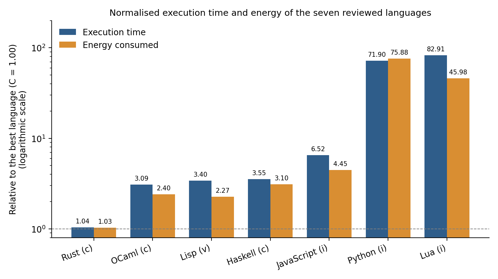
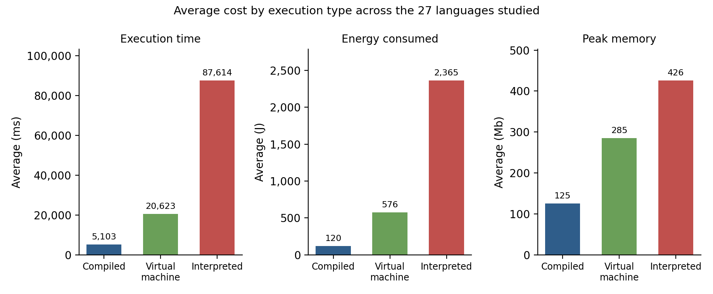

## Introduction

This section reviews how programming languages are implemented and executed. Existing implementations range from direct tree-walking interpreters to bytecode virtual machines, native-code compilers, and multi-tier just-in-time (JIT) systems (Nystrom, 2021; Smith & Nair, 2005). The review examines execution implementations across different paradigms, including Rust, Haskell, Lisp, Python, Lua, OCaml, and JavaScript runtimes. Their implementation approaches and common challenges are compared to identify where the literature leaves a gap that a minimal, readable, educational interpreter could fill (Nystrom, 2021; Smith & Nair, 2005). The review also examines the tools that implementers use to build lexers and parsers, and how far those tools place abstraction between a student and the implementation (Louden, 1997; Nystrom, 2021).

## How Each Language Implements Execution

Rust uses a compiled implementation in which the compiler checks ownership and borrowing rules at compile time, with violations preventing compilation; Rust's toolchain produces executables containing native machine code (Klabnik & Nichols, 2023). These rules constrain how values are accessed and modified, providing strong compile-time guarantees and a relatively explicit model of ownership (Klabnik & Nichols, 2023). This can make many classes of program behaviour predictable, although the ownership and borrowing system also introduces concepts that learners must understand before writing some classes of Rust programs (Klabnik & Nichols, 2023).

Python provides a high-level programming model based on objects and dynamic name binding. In Python, names refer to objects, and an object's type is a property of the object rather than of the name bound to it (Python Software Foundation, n.d.). In CPython, most objects are heap allocated and represented through object pointers in the C API (Python Software Foundation, n.d.). This dynamic model permits a name to be rebound to values of different types during execution, which supports flexibility but means that some type-related errors are discovered only when the relevant operation is executed. The language therefore places relatively little static type-checking burden on the programmer compared with statically typed languages such as Rust and OCaml (Python Software Foundation, n.d.; Pierce, 2002). Python also supports multiple programming styles and provides both imperative and functional facilities, making it useful for contrasting programming paradigms (Python Software Foundation, n.d.).

The Glasgow Haskell Compiler (GHC) supports both interpreted and compiled execution. GHCi normally converts loaded Haskell modules to bytecode and executes that bytecode using an interpreter, while Haskell programs can also be compiled to object code and native executables (Marlow, 2010; GHC Team, 2026a). Haskell uses non-strict, lazy evaluation: computation of an expression can be deferred until its result is needed, with sharing used to avoid repeatedly computing the same expression (Launchbury, 1993; HaskellWiki, n.d.). Haskell also defines conditional expressions as values: an `if ... then ... else ...` expression returns the value of the selected branch, and the condition must have type `Bool` while the two branches must have the same type (Marlow, 2010). Lazy evaluation is a significant semantic feature, but it also complicates reasoning about evaluation order and resource usage, especially when combined with effects or other strict operations (Launchbury, 1993).

Lua, like many virtual-machine-based interpreters, compiles source code to bytecode executed by a register-based virtual machine. The Lua 5.1 virtual machine used 38 opcodes, illustrating how a relatively small instruction set can support a practical scripting language (Man, 2006). The official Lua reference manual likewise describes Lua as dynamically typed and as executing bytecode on a register-based virtual machine (Ierusalimschy et al., 2025). In Lua, variables do not have fixed types; values carry types, and values—including functions—are first-class (Ierusalimschy et al., 2025). This makes the language flexible while shifting many type checks to runtime.

OCaml supports both bytecode and native-code execution. The `ocamlc` compiler produces bytecode that can be run by `ocamlrun`, while `ocamlopt` compiles OCaml programs to native code; the native-code compiler generally provides faster execution at the cost of longer compilation and larger executables (Leroy et al., 2026a, 2026b). OCaml uses automatic type inference based on the Hindley–Milner algorithm, allowing many programs to be statically checked without explicit type annotations on every expression (Leroy et al., 2026c). OCaml also performs exhaustiveness analysis on pattern matches and reports non-exhaustive matches as warnings by default (Leroy et al., 2026c, 2026d). This combination gives programmers strong static checking without requiring all types to be written explicitly.

Lisp is a family of languages rather than a single contemporary implementation, but McCarthy's original Lisp provides a particularly useful model for understanding minimal interpreters. The original Lisp work defines symbolic expressions (S-expressions), a small set of elementary functions, conditional expressions, lambda expressions, and a universal `apply` function that serves as an interpreter for Lisp programs (McCarthy, 1960). The representation of programs as symbolic expressions means that the same structural representation can be manipulated as data, a property now commonly described as homoiconicity (McCarthy, 1960). The original evaluator also shows that a compact language core can be implemented using a comparatively small evaluation mechanism (McCarthy, 1960).

The JavaScript runtime V8 uses a tiered execution architecture rather than being purely an interpreter or purely a traditional ahead-of-time compiler. JavaScript is first translated to Ignition bytecode and interpreted; as code becomes hot, V8 can move it through additional compilation tiers, including Sparkplug, Maglev, and TurboFan, to produce progressively more optimized native machine code (V8, 2021, 2023). This adaptive strategy improves startup and peak performance trade-offs by using fast execution mechanisms early and more expensive optimization when runtime feedback justifies it (V8, 2017, 2023). The architecture is consequently much more sophisticated than the execution model of a tree-walking interpreter.

## Common Challenges Interpreters Face

### Performance vs. Simplicity

Programming-language implementations must balance execution speed, compilation cost, memory use, portability, and implementation complexity. Virtual machines and interpreters introduce execution overhead, while compilation and dynamic translation can improve runtime performance at the cost of additional machinery and compilation work (Smith & Nair, 2005). The appropriate balance depends on the goals of the implementation rather than on a single universally superior architecture.

Rust illustrates a compile-time-heavy approach: ownership and borrowing are enforced by the compiler, while the resulting program executes as native code (Klabnik & Nichols, 2023). Python emphasizes dynamic objects and runtime flexibility, while interpreted execution introduces runtime overhead compared with directly executing native code (Python Software Foundation, n.d.; Smith & Nair, 2005). OCaml offers an explicit choice between bytecode and native compilation: bytecode can be produced and run through `ocamlrun`, while native compilation generally gives faster execution but requires more compilation work (Leroy et al., 2026a, 2026b). JavaScript runtimes push this trade-off into the runtime itself by adapting execution based on observed program behaviour and selectively compiling hot code (V8, 2017, 2021, 2023).

Benchmark evidence shows the size of this trade-off. Pereira et al. (2017) measured the execution time, energy consumption, and peak memory of 27 languages on ten benchmark problems taken from the Computer Language Benchmarks Game, and normalised each result to the best-performing language in that category. Figure 2.1 reproduces the values that the study reports for the seven languages reviewed in this chapter. Rust, a compiled language, came within about 4% of the fastest language on both time and energy (1.04 and 1.03). OCaml, Lisp, and Haskell took between 3.09 and 3.55 times as long, and JavaScript took 6.52 times as long. The interpreted languages Python and Lua took about 72 and 83 times as long as the fastest language (Pereira et al., 2017).

*Figure 2.1: Execution time and energy consumption of the seven reviewed languages, normalised to the best language in each category (C = 1.00) and drawn on a logarithmic scale. Data from Table 4 of Pereira et al. (2017). The letters in the labels are the study's own classification: (c) compiled, (v) virtual machine, (i) interpreted.*

Grouping all 27 languages by execution type shows the same pattern (Figure 2.2). On average, a compiled-language solution took 5,103 ms and 120 J, a virtual-machine solution took 20,623 ms and 576 J, and an interpreted solution took 87,614 ms and 2,365 J, while average peak memory rose from 125 Mb to 285 Mb and then 426 Mb (Pereira et al., 2017).

*Figure 2.2: Average execution time, energy consumption, and peak memory by execution type across the 27 languages studied. Values from Sections 3.1 and 3.2 of Pereira et al. (2017).*

Three cautions apply to these data. First, the benchmark programs were written by experts to be as fast as possible, so the figures show what tuned implementations achieve and not what a small, straightforward interpreter would achieve. Second, the measurements come from one machine and the compiler and runtime versions of 2017, and the authors expect results to change as compilers and benchmark solutions evolve. Third, the study does not isolate tree-walking interpretation: its interpreted category contains languages with very different internals, and it classes JavaScript as interpreted although V8 compiles frequently executed code to native machine code (Pereira et al., 2017; V8, 2023). The figures therefore quantify the cost side of the performance–simplicity trade-off, and they do not measure the cost of any particular interpreter design.

A tree-walking interpreter can expose the core relationship between syntax, evaluation rules, and program behaviour without requiring the additional compiler and virtual-machine layers found in more performance-oriented systems (Nystrom, 2021). This does not imply that tree-walking is generally faster; rather, the implementation can remain direct enough to study and extend while still supporting a complete small language (Nystrom, 2021).

### Type-Error Timing

A central implementation decision is when type errors should be detected. Static type systems are designed to reject certain classes of erroneous programs before execution, whereas dynamically typed systems defer many checks until operations are performed at runtime (Pierce, 2002). The choice therefore changes both the runtime behaviour of the language and the responsibilities placed on the implementation.

Rust uses compile-time checking for ownership and many type-related constraints; programs that violate the relevant rules do not compile (Klabnik & Nichols, 2023). Rust also performs pattern and exhaustiveness analysis as part of compile-time checking (Klabnik & Nichols, 2023). OCaml similarly rejects statically ill-typed programs during compilation and additionally reports non-exhaustive pattern matching through warnings (Leroy et al., 2026c, 2026d). Python and Lua, in contrast, are dynamically typed and perform type-dependent checks during execution (Python Software Foundation, n.d.; Ierusalimschy et al., 2025).

Early detection is also relevant to novice programmers, although the evidence is indirect. Research on novice programmers shows that compiler diagnostics can create learning difficulties when errors generate multiple confusing messages, while structured error categorisation can improve students' ability to address them (Nagura & Kondo, 2024). This is evidence about how errors are reported and not a conclusion that early checking itself improves learning. The systems reviewed that check types early do so with substantial machinery: Rust through ownership and borrowing rules, and OCaml through Hindley–Milner inference and exhaustiveness analysis (Klabnik & Nichols, 2023; Leroy et al., 2026c, 2026d). The sources reviewed do not describe a lightweight hybrid scheme, with explicit function signatures and inferred local variables, implemented as a separate pass in a small interpreter that a student can read in full.

### Syntax and Complexity

The issue of complexity can be viewed from two perspectives: the complexity required to implement a language and the complexity experienced by programmers who use it. These dimensions do not necessarily move together. A language may use a sophisticated implementation to provide a relatively convenient programming model, or expose more of its complexity directly to programmers.

Modern JavaScript runtimes illustrate implementation complexity through multi-tier interpretation and compilation, runtime profiling, and adaptive optimization (V8, 2017, 2021, 2023). Lisp provides a contrasting case: McCarthy's original formalism defines a small language core with S-expressions, a small set of primitive operations, and an evaluator that directly interprets those expressions (McCarthy, 1960). This illustrates how a compact language kernel can make an interpreter conceptually manageable, although users may have to construct higher-level facilities from the available primitives.

Rust places substantial language-enforced structure on the programmer through ownership, borrowing, types, and pattern checking (Klabnik & Nichols, 2023). Research on programming-language syntax also shows that syntax is an important barrier for novices and that the intuitiveness of language keywords and constructs can be studied empirically rather than assumed (Lappi et al., 2023). This suggests that the relevant measure for an educational language is not only the number of features but also whether its rules and constructs are explicit, consistent, and sufficiently expressive for educational tasks.

The two ends of this range leave a middle ground. At one end, Rust's ownership, lifetimes, and borrowing rules add substantial implementation and conceptual complexity (Klabnik & Nichols, 2023). At the other, McCarthy's Lisp kernel keeps the implementation small by exposing a small set of primitive forms, which leaves users to build higher-level facilities from them (McCarthy, 1960). The sources reviewed describe these two ends, strict rules at a high implementation cost and a small kernel with the work left to the user, but they do not describe a small implementation that gives explicit, predictable rules and also provides common constructs directly.

### Feature Completeness

The comparison of the selected languages reveals a common set of capabilities—conditional execution, functions, iteration, higher-order operations, and input/output—implemented through substantially different language and runtime mechanisms (Marlow, 2010; Python Software Foundation, n.d.; Klabnik & Nichols, 2023; Ierusalimschy et al., 2025; Leroy et al., 2026a). Every language reviewed provides these capabilities, whereas the richer abstractions built on them differ in how much implementation machinery they need relative to the capability they add.

Conditional constructs are fundamental to program control. Rust provides `if`/`else` expressions and exhaustive pattern matching through `match` (Klabnik & Nichols, 2023). Python provides `if`, `elif`, and optional `else` clauses (Python Software Foundation, n.d.). OCaml treats conditionals as expressions whose branches produce a value (Leroy et al., 2026c). Lisp uses conditional special forms, and the original McCarthy formulation includes conditional expressions as a core part of its evaluation model (McCarthy, 1960). Haskell's `if` expression likewise evaluates a Boolean condition and returns one of two branches, which must have the same type (Marlow, 2010). All the surveyed languages provide conditional execution, which makes it a core capability of the languages reviewed.

File input and output provide programs with access to persistent external data. Python supplies the built-in `open()` mechanism and file objects (Python Software Foundation, n.d.). Rust provides file operations through `std::fs`, with functions such as `read_to_string` returning `Result` values to represent success or failure (Klabnik & Nichols, 2023). Node.js exposes file-system operations through its `fs` module, including synchronous, callback-based, and promise-based forms (Node.js, n.d.). Lua provides file input/output through its `io` library, including `io.open()` and related file operations (Ierusalimschy et al., 2025). File I/O is therefore a useful capability for moving beyond self-contained demonstrations and supporting programs that read or persist external data.

Anonymous functions are closely related to lambda calculus and were present in the original Lisp formulation through lambda expressions (McCarthy, 1960). Python's `lambda` expression creates an anonymous function (Python Software Foundation, n.d.). Haskell supports lambda abstractions directly, and Rust and OCaml provide anonymous functions or closures through their function-expression forms (Marlow, 2010; Klabnik & Nichols, 2023; Leroy et al., 2026c). Anonymous functions are useful for concise higher-order programming, but they are not essential to it: a named function that can be passed as a value supports the same operations, whereas anonymous functions require additional syntax and, in most of the languages above, closure machinery that retains the surrounding environment (Klabnik & Nichols, 2023).

Higher-order functions such as `map` and `filter` allow a function to be applied to collection elements or used to select elements meeting a predicate. Python provides `map()` and `filter()` as built-in functions that return iterators (Python Software Foundation, n.d.). Haskell provides `map` and `filter` over lists, while OCaml provides `List.map` and `List.filter` (Marlow, 2010; Leroy et al., 2026e). Rust provides analogous functionality through lazy iterator adapters such as `map` and `filter` (Klabnik & Nichols, 2023). These operations require only that a function can be passed as a value, so they do not depend on anonymous-function syntax.

Python and Haskell additionally provide comprehension syntax for concise collection construction and transformation (Python Software Foundation, n.d.; Marlow, 2010). Comprehensions provide an alternative surface notation rather than a fundamentally new evaluation capability. Rust's iterator abstraction is powerful and extensible, but it relies on a trait-based model that brings substantial type-system and library machinery with it (Klabnik & Nichols, 2023).

Iteration is the sequential processing of elements in a collection or sequence. Python's `for` statement creates an iterator and assigns successive values to the loop target, while Python also supports generators through `yield` (Python Software Foundation, n.d.). Lua supports numeric and generic `for` loops, including iteration over table elements through `pairs()` and `ipairs()` (Ierusalimschy et al., 2025). Rust expresses iteration through the `Iterator` trait and lazy adapters (Klabnik & Nichols, 2023). Haskell commonly expresses repeated computation through recursive functions over lists and other structures rather than imperative `for` loops (Marlow, 2010). Basic looping constructs provide iteration without requiring a separate iterator abstraction, as Lua's numeric `for` loop illustrates (Ierusalimschy et al., 2025).

Taken together, the comparison shows that conditional expressions, named functions, `map()` and `filter()`, simple iteration, and file input/output are widely available, and that they can be supported without the more elaborate mechanisms that surround them in the larger languages: anonymous functions and closures, comprehension syntax, and trait-based iterator systems. The sources reviewed describe these mechanisms and their costs one language at a time (Marlow, 2010; Python Software Foundation, n.d.; Klabnik & Nichols, 2023; Ierusalimschy et al., 2025; Leroy et al., 2026a), but they do not show how a small interpreter can provide the common capabilities without them.

### Abstraction and Transparency in Implementation Tools

Implementers do not always write the front end of a language by hand. Lexer generators such as Lex produce a scanner from a set of regular-expression rules, and parser generators such as Yacc and ANTLR produce a parser from a grammar specification (Lesk & Schmidt, 1975; Johnson, 1975; Parr, 2013). Rust has equivalent tools, for example LALRPOP, which generates an LR(1) parser from a grammar file (LALRPOP, n.d.). Compiler textbooks present these tools as standard practice (Aho et al., 2006), and Louden (1997) notes that they can make an extensive compiler project manageable within a course. Nystrom (2021) likewise observes that tools such as Lex and Flex can return a complete scanner from a handful of regular expressions.

The same tools carry a cost for a reader who wants to see how a language is implemented. The specification replaces the code that would otherwise be studied: the scanning loop, the lookahead decisions that separate `=` from `==`, the functions that encode operator precedence, and the construction of syntax-tree nodes are produced by the tool or hidden inside a library, so they do not appear in the project's own source. Louden (1997) warns that using Lex and Yacc in a first course risks students failing to understand the algorithms that are actually being applied. Nystrom (2021) accordingly writes the scanner by hand, because the aim is to understand how a scanner works and not to delegate that task, and presents recursive descent as the simplest way to build a parser, one that needs no tool such as Yacc, Bison, or ANTLR and only straightforward handwritten code.

Similar concerns about the distance between a learner and an implementation appear elsewhere in the compiler-education literature. Ghuloum (2006) describes compilers as perceived to be magical and beyond the reach of ordinary programmers, and observes that compiler books tend to fall into two groups: simplified toy compilers that do not prepare a novice to build a useful one, and industrial-strength optimising compilers that are too large to follow. His response is a compiler built in many small steps, each of which yields a fully working system (Ghuloum, 2006).

Abstraction is not objectionable in itself, and the sources reviewed do not describe generated front ends as poor engineering. The point that emerges from the review concerns learning: when a student's purpose is to see how an implementation works, abstraction that is not needed to express the algorithm, such as generated scanners and parsers, parser-combinator libraries, or large third-party frameworks, stands between the student and the mechanism. Comparable layers exist inside the languages reviewed, where Rust's trait-based iterators and V8's tiered pipeline add structure between the programmer and the underlying evaluation (Klabnik & Nichols, 2023; V8, 2023).

The hand-written route is documented in educational texts (Nystrom, 2021; Ghuloum, 2006). Nystrom's interpreter, however, implements a dynamically typed language and so does not include a static type-checking stage. A complete interpreter whose lexer, parser, type checker, and evaluator are all written out in the project's own code, with no generated code and no third-party parsing library, would let a student follow the whole path from source text to program output without unnecessary abstraction. The review found no source that documents such an interpreter together with early static type checking.

## Summary of Findings and Identified Gap

The review compared how seven languages and runtimes are implemented and examined five challenges that implementations face. The comparison showed that performance-oriented systems rely on machinery far larger than a learner can read, and that the cost of simpler execution models is measurable (Figures 2.1 and 2.2); that languages differ in when they report type errors and in how much machinery they need to do so; that complexity can sit in the implementation, in the language the programmer sees, or in both; that capabilities common to all the languages are supported through very different mechanisms; and that generated lexers and parsers, although convenient, place abstraction between a student and the implementation. Each finding leaves something unaddressed in the literature reviewed. Table 2.1 sets out the evidence for each gap and what the literature does not provide.

*Table 2.1: Gaps identified in the literature reviewed*

| Gap | Evidence from the review | What the reviewed literature does not provide |
| --- | --- | --- |
| **1. Comparative gap** | Each source describes one language, runtime, or technique (Klabnik & Nichols, 2023; Python Software Foundation, n.d.; V8, 2023). Benchmark studies compare speed, energy, and memory but not readability or implementation scale (Pereira et al., 2017). | A comparison of implementation strategies, typing disciplines, and feature sets on the dimensions that matter to a small educational interpreter: implementation size, timing of type errors, complexity, and the cost of features. |
| **2. Specification gap** | Educational texts build interpreters and compilers in stages (Nystrom, 2021; Ghuloum, 2006), and production languages are defined by reference manuals (Marlow, 2010; Ierusalimschy et al., 2025). | Requirements and scope for a small reference interpreter, stated so that the finished implementation can be checked against them. |
| **3. Transparency gap** | Lexer and parser generators and libraries produce the front end from specifications (Lesk & Schmidt, 1975; Johnson, 1975; Parr, 2013; LALRPOP, n.d.), and students using them may not learn the underlying algorithms (Louden, 1997). Production runtimes spread execution across several tiers (V8, 2023). | A complete interpreter in which every stage, including the lexer and parser, is written out in the project's own code, so that a student can see the whole implementation without unnecessary abstraction. |
| **4. Early-checking gap** | Rust and OCaml check types early with substantial machinery, while Python and Lua check at run time (Klabnik & Nichols, 2023; Leroy et al., 2026c; Python Software Foundation, n.d.; Ierusalimschy et al., 2025). Error reporting affects novices (Nagura & Kondo, 2024). | A lightweight hybrid scheme, with explicit function signatures and inferred local variables, implemented as a separate pass in a small, readable interpreter. |
| **5. Feature-set gap** | Higher-order operations, anonymous functions, comprehensions, and iterators are provided through lambda syntax, closures, traits, or generic types (Python Software Foundation, n.d.; Klabnik & Nichols, 2023; Leroy et al., 2026e). | An account of how common higher-order operations, conditionals, iteration, and file input/output can be supported at small scale without those mechanisms. |
| **6. Verification and documentation gap** | Educational sources use tests to confirm each stage of a build (Ghuloum, 2006) but the sources reviewed do not link tests to stated requirements. | A worked example in which requirements, design, implementation, and tests are documented and linked, so that a reader can follow a feature from specification to verification. |

Taken together, these six gaps form the problem stated in Chapter One: within the literature reviewed, no source brings together a small, fully visible, hand-written interpreter with early static type checking under hybrid typing, common constructs provided directly, a deliberately limited feature set, and stage-by-stage verification against explicit requirements. The project reported in the following chapters fills these gaps by designing, implementing, documenting, and verifying Licht, a small beginner-oriented language with a reference interpreter written in Rust, which Chapter One introduces. The gaps are stated relative to the literature reviewed in this chapter, which covers seven languages and runtimes and does not survey every educational language or implementation strategy.

## Glossary

**Lexer generator and parser generator**  
Tools that produce a scanner or a parser from a declarative specification, such as regular-expression rules or a grammar, instead of requiring the implementer to write the scanning loop or the parsing functions by hand. Lex and Yacc are the classic examples (Lesk & Schmidt, 1975; Johnson, 1975; Aho et al., 2006).

**Recursive-descent parsing**  
A top-down parsing technique in which each rule of the grammar is implemented as one function that calls the functions for the rules below it. It can be written directly by hand without a parser generator (Nystrom, 2021).

**Generalized Algebraic Data Type (GADT)**  
A data type whose constructors can express more specific type relationships than ordinary algebraic data types. GADTs can therefore allow a type system to represent relationships between constructors and result types more precisely (Leroy et al., 2026c; Pierce, 2002).

**Hindley–Milner style type inference**  
A static type-inference approach in which the compiler determines types from how expressions are used and can infer a most-general, or principal, type without requiring explicit annotations everywhere (Leroy et al., 2026c).

**Algebraic Data Type (ADT)**  
A data type constructed from combinations of alternatives (sum types) and collections of fields (product types). Algebraic data types provide a way to model values with a fixed structural set of alternatives (Pierce, 2002).

**Bytecode**  
An intermediate representation of a program intended for execution by a virtual machine rather than directly by the target processor. Bytecode separates a language implementation from the host machine's native instruction set (Smith & Nair, 2005; Ierusalimschy et al., 2025).

**Tree-walking interpreter**  
An interpreter that executes a program by directly traversing its Abstract Syntax Tree rather than first translating the program into a separate bytecode or native-code representation (Nystrom, 2021).

**JIT (Just-In-Time) compilation**  
A compilation strategy in which code is compiled into native machine code during program execution rather than entirely before execution starts. Modern JIT runtimes commonly use runtime information to decide which code should receive more expensive optimization (V8, 2017, 2023).

**Pattern matching**  
A mechanism for selecting program behaviour by comparing a value with patterns that describe its structure, such as constructors, tuples, records, or literals (Klabnik & Nichols, 2023; Marlow, 2010).

**Exhaustiveness / exhaustive matching**  
The property that the patterns in a match expression cover all possible values allowed by the type being matched. Exhaustiveness analysis can therefore identify omitted cases before execution in statically checked languages (Klabnik & Nichols, 2023; Leroy et al., 2026d).

**First-class values/functions**  
A property in which values, including functions, can be stored in variables, passed as arguments, returned from functions, and used in expressions as ordinary values (Pierce, 2002; Ierusalimschy et al., 2025).

**Closure**  
A function value that retains access to variables from the environment in which it was created. Closures therefore combine executable code with access to captured surrounding bindings (Klabnik & Nichols, 2023).

**Homoiconicity**  
A language property in which the structural representation of programs uses the same kinds of data structures that the language manipulates as data. Lisp's use of S-expressions provides the classic example of this idea (McCarthy, 1960).

## References

Aho, A. V., Lam, M. S., Sethi, R., & Ullman, J. D. (2006). *Compilers: Principles, techniques, and tools* (2nd ed.). Pearson.

Ghuloum, A. (2006). An incremental approach to compiler construction. In *Proceedings of the 2006 Scheme and Functional Programming Workshop* (University of Chicago Technical Report TR-2006-06). https://www.schemeworkshop.org/2006/11-ghuloum.pdf

HaskellWiki. (n.d.). *Lazy evaluation*. https://wiki.haskell.org/Lazy_evaluation

Ierusalimschy, R., de Figueiredo, L. H., & Celes, W. (2025). *Lua 5.4 reference manual*. Lua.org. https://www.lua.org/manual/5.4/manual.html

Johnson, S. C. (1975). *Yacc: Yet another compiler-compiler* (Computing Science Technical Report No. 32). Bell Laboratories.

Karachalias, G., Schrijvers, T., Vytiniotis, D., & Jones, S. P. (2015). GADTs meet their match: Pattern-matching warnings that account for GADTs, guards, and laziness. In *Proceedings of the 20th ACM SIGPLAN International Conference on Functional Programming* (pp. 424–436). ACM. https://doi.org/10.1145/2784731.2784748

Klabnik, S., & Nichols, C. (2023). *The Rust programming language* (2nd ed.). No Starch Press. https://nostarch.com/rust-programming-language-2nd-edition

LALRPOP. (n.d.). *LALRPOP: LR(1) parser generator for Rust* [Software documentation]. GitHub. https://github.com/lalrpop/lalrpop

Lappi, V., Tirronen, V., & Itkonen, J. (2023). A replication study on the intuitiveness of programming language syntax. *Software Quality Journal, 31*, 1211–1240. https://doi.org/10.1007/s11219-023-09631-7

Launchbury, J. (1993). A natural semantics for lazy evaluation. In *Proceedings of the 20th ACM SIGPLAN-SIGACT Symposium on Principles of Programming Languages* (pp. 144–154). ACM. https://doi.org/10.1145/158511.158618

Leroy, X., Doligez, D., Frisch, A., Garrigue, J., Rémy, D., Sivaramakrishnan, K., & Vouillon, J. (2026a). *The OCaml system: Native-code compilation (ocamlopt)*. OCaml Documentation. https://ocaml.org/manual/5.5/native.html

Leroy, X., Doligez, D., Frisch, A., Garrigue, J., Rémy, D., Sivaramakrishnan, K., & Vouillon, J. (2026b). *The OCaml system: The runtime system (ocamlrun)*. OCaml Documentation. https://ocaml.org/manual/5.5/runtime.html

Leroy, X., Doligez, D., Frisch, A., Garrigue, J., Rémy, D., Sivaramakrishnan, K., & Vouillon, J. (2026c). *The OCaml language*. OCaml Documentation. https://ocaml.org/manual/5.5/expr.html

Leroy, X., Doligez, D., Frisch, A., Garrigue, J., Rémy, D., Sivaramakrishnan, K., & Vouillon, J. (2026d). *Common error messages: Pattern matching warnings and errors*. OCaml Documentation. https://ocaml.org/docs/common-errors

Leroy, X., Doligez, D., Frisch, A., Garrigue, J., Rémy, D., Sivaramakrishnan, K., & Vouillon, J. (2026e). *Stdlib.List*. OCaml Documentation. https://ocaml.org/manual/5.5/api/Stdlib.List.html

Lesk, M. E., & Schmidt, E. (1975). *Lex — A lexical analyzer generator* (Computing Science Technical Report No. 39). Bell Laboratories.

Louden, K. C. (1997). *Compiler construction: Principles and practice*. PWS Publishing. (Preface available at https://www.cs.sjsu.edu/faculty/louden/cmptext/preface.htm)

Man, K.-H. (2006). *A no-frills introduction to Lua 5.1 VM instructions* (Version 0.1). https://archive.org/details/a-no-frills-intro-to-lua-5.1-vm-instructions

Marlow, S. (Ed.). (2010). *Haskell 2010 language report*. Haskell.org. https://www.haskell.org/definition/haskell2010.pdf

McCarthy, J. (1960). Recursive functions of symbolic expressions and their computation by machine, Part I. *Communications of the ACM, 3*(4), 184–195. https://doi.org/10.1145/367177.367199

Nagura, M., & Kondo, R. (2024). A learning support method for novice programmers based on categorization of compilation error messages. *Journal of Software and Systems, 41*(2), 2_3–2_18. https://doi.org/10.11309/jssst.41.2_3

Node.js. (n.d.). *File system*. https://nodejs.org/api/fs.html

Nystrom, R. (2021). *Crafting interpreters*. https://craftinginterpreters.com/

Parr, T. (2013). *The definitive ANTLR 4 reference*. Pragmatic Bookshelf.

Pereira, R., Couto, M., Ribeiro, F., Rua, R., Cunha, J., Fernandes, J. P., & Saraiva, J. (2017). Energy efficiency across programming languages: How do energy, time, and memory relate? In *Proceedings of the 10th ACM SIGPLAN International Conference on Software Language Engineering* (pp. 256–267). ACM. https://doi.org/10.1145/3136014.3136031

Pierce, B. C. (2002). *Types and programming languages*. MIT Press. https://mitpress.mit.edu/9780262162098/types-and-programming-languages/

Python Software Foundation. (n.d.). *The Python language reference*. Python Documentation. https://docs.python.org/3/reference/index.html

Smith, J. E., & Nair, R. (2005). The architecture of virtual machines. *Computer, 38*(5), 32–38. https://doi.org/10.1109/MC.2005.173

Steele, G. L. (1990). *Common LISP: The language* (2nd ed.). Digital Press. https://www.cs.cmu.edu/Groups/AI/html/cltl/cltl2.html

V8. (2017, May 15). *Launching Ignition and TurboFan*. https://v8.dev/blog/launching-ignition-and-turbofan

V8. (2021, April 27). *Sparkplug — a non-optimizing JavaScript compiler*. https://v8.dev/blog/sparkplug

V8. (2023, December 5). *Maglev: V8's fastest optimizing JIT*. https://v8.dev/blog/maglev

